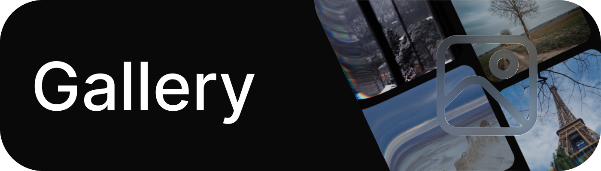
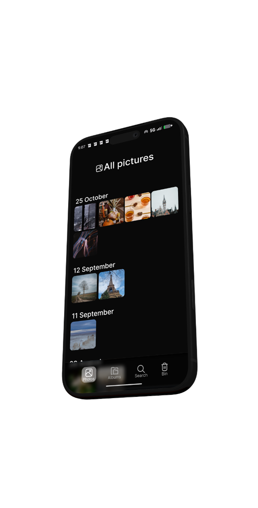
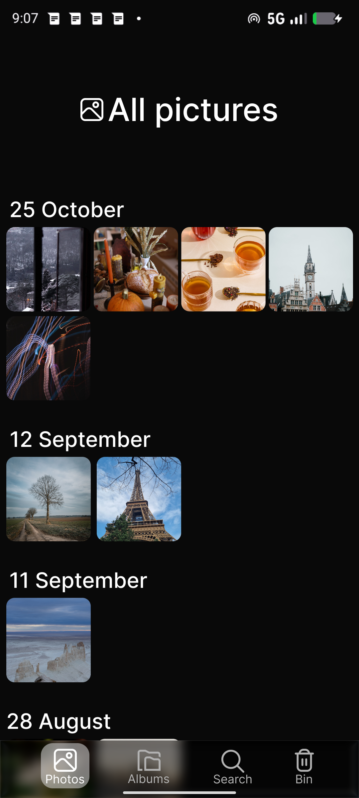
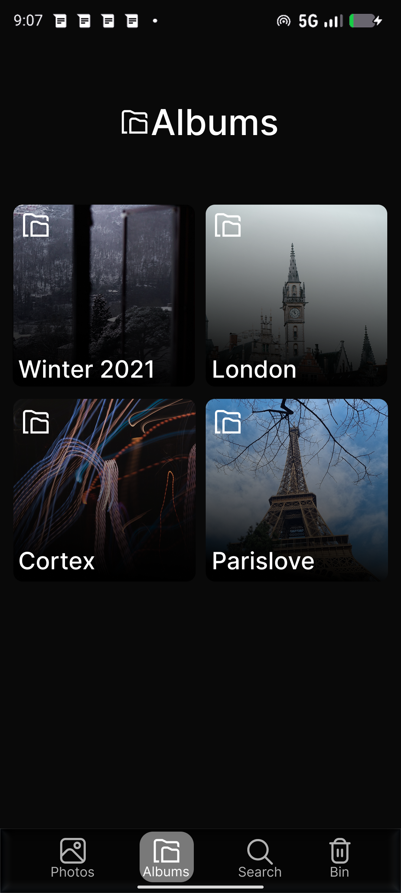
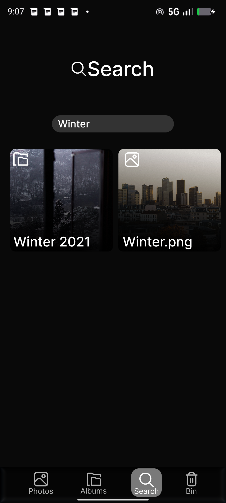
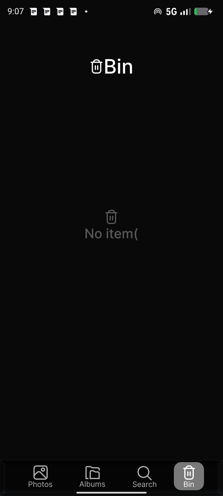

<div align="center">
  

  <br />

  # Gallery

  **Your memories. Beautifully organized.**

  A clean, modern gallery experience for Android, built with Jetpack Compose.

  <br />

  [](https://www.android.com/)
  [](https://kotlinlang.org/)
  [](https://developer.android.com/compose)
  [](./LICENSE)

  <br />

  [**Explore screenshots**](#screenshots) · [**Get the source**](#get-started) · [**Credits**](#credits)
</div>

---

## A gallery that feels right

Your photos and videos deserve an interface that stays out of the way. **Gallery** brings a thoughtful, modern design to everyday media browsing, with a focus on simplicity, clarity, and a comfortable Android experience.

This repository is a fork of **[GrapheneOS Gallery](https://github.com/GrapheneOS/Gallery)**, which is itself based on **[ReFra](https://github.com/IacobIonut01/Gallery)**. It builds on the work of the original developers and the open-source community.

<div align="center">
  
</div>

## Highlights

- **Clean by design** — a modern interface that puts your media first.
- **Built with Jetpack Compose** — a native Android UI developed with Kotlin.
- **Made for everyday browsing** — a straightforward place to explore your photos and videos.
- **Open source** — transparent code, community contributions, and a foundation you can build on.

## Screenshots

<div align="center">
  <table>
    <tr>
      <td align="center" width="25%"></td>
      <td align="center" width="25%"></td>
      <td align="center" width="25%"></td>
      <td align="center" width="25%"></td>
    </tr>
  </table>
  <sub>Four views of the Gallery experience.</sub>
</div>

## Get started

Browse the source code, follow development, or clone this repository:

```bash
git clone https://github.com/ifny75/Gallery.git
```

You can also check the [Releases page](https://github.com/ifny75/Gallery/releases) for published builds, if available.

## Project lineage

```text
ReFra (original project)
    └── GrapheneOS Gallery (fork)
          └── ifny75/Gallery (this fork)
```

## Credits

This project stands on the work of the developers and contributors who came before it.

- **[ReFra](https://github.com/IacobIonut01/Gallery)** — the original Android gallery project.
- **[GrapheneOS Gallery](https://github.com/GrapheneOS/Gallery)** — the upstream fork on which this repository is based.
- **[Contributors](https://github.com/ifny75/Gallery/graphs/contributors)** — everyone helping improve the codebase.

This repository is an independent fork. It is not presented as an official release of GrapheneOS or ReFra.

## License

Distributed under the [Apache License 2.0](./LICENSE). See the repository license for details.

---

<div align="center">
  <sub>Made with care for a better gallery experience.</sub>
  <br />
  <sub>If you like this project, consider giving the repository a ⭐.</sub>
</div>
