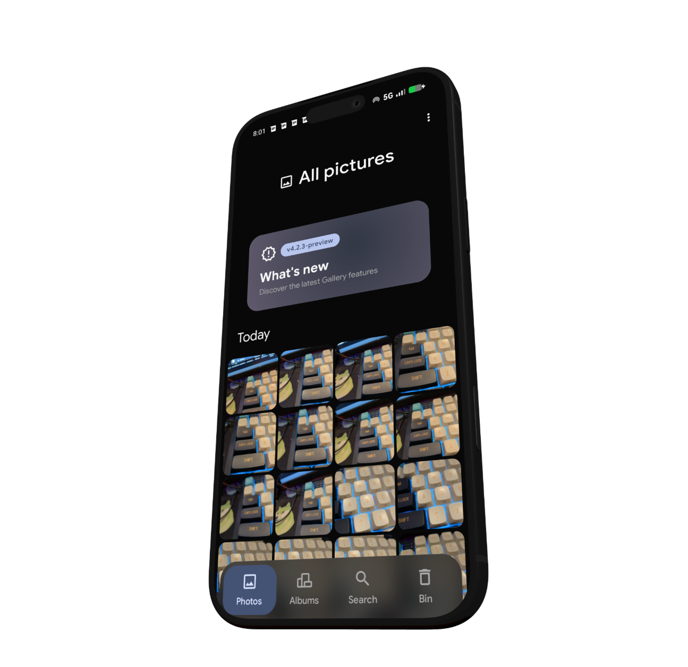
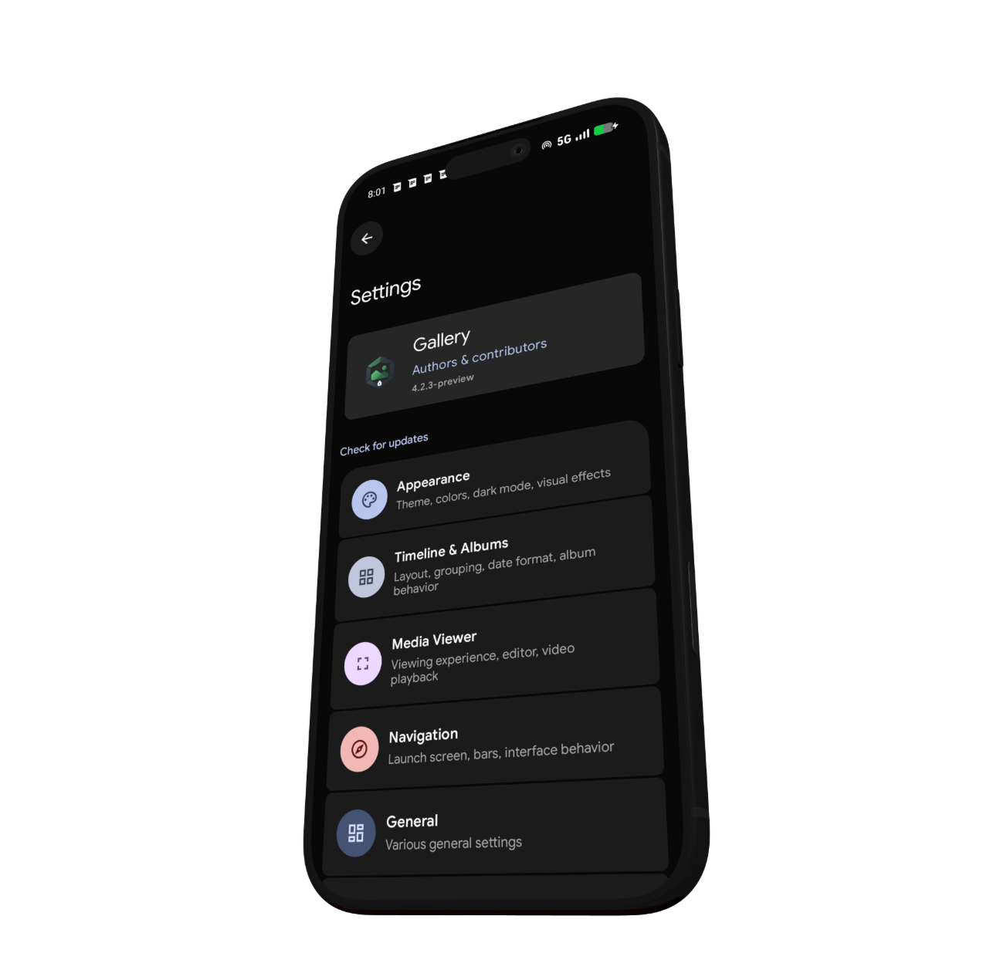
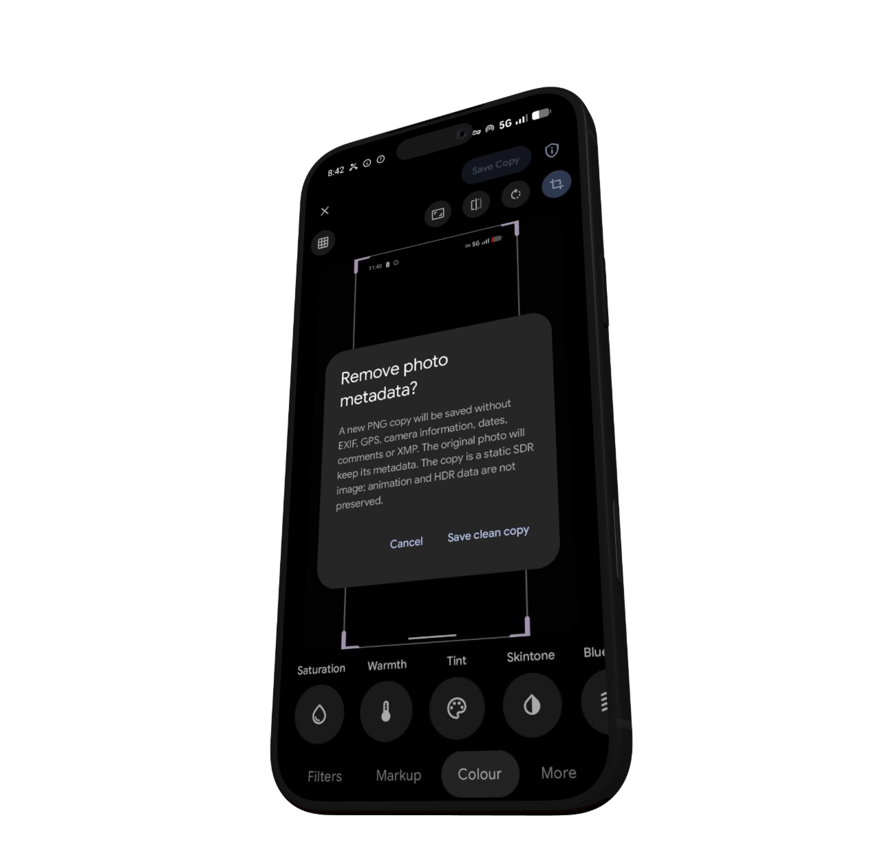

<div align="center">
<tr>
    <td></td>

# Gallery

**Your photos. A calmer Android experience.**

A redesigned Android gallery by [ifny75](https://github.com/ifny75), part of [Valanium](https://valanium.com/apps).
Built with Kotlin and Jetpack Compose, with system theme accents and a clean dark interface.

[](https://www.android.com/)
[](https://kotlinlang.org/)
[](https://developer.android.com/compose)
[](./LICENSE)

[**Download APK**](https://github.com/ifny75/Gallery/releases) · [**Valanium apps**](https://valanium.com/apps) · [**Changes**](https://github.com/ifny75/Gallery/commits/main/) · [**Credits**](#credits)

</div>

## A look inside

<table>
  <tr>
    <th width="33%">Photos</th>
    <th width="33%">Settings</th>
    <th width="33%">Metadata removal</th>
  </tr>
  <tr>
    <td></td>
    <td></td>
    <td></td>
  </tr>
</table>

## What makes this fork different

- **A new interface.** Photos, Albums, Search and Bin share rounded media previews, system theme accents and blurred navigation panels.
- **Smoother browsing.** Photos scroll while the large title moves into the top bar. Search navigation and date-heading animations have been improved.
- **Metadata-free copies.** Save individual or selected photos without EXIF, GPS or XMP, with a warning before export. Originals remain unchanged; exports are new static SDR PNG copies.
- **Updated Appearance.** Preview the current Gallery layout and choose system, neutral or custom accent colors, dark mode and visual effects.
- **Updates from this repository.** Gallery checks compatible [ifny75/Gallery releases](https://github.com/ifny75/Gallery/releases), offers an update banner and asks before opening the APK download. Android handles installation confirmation.
- **A simpler first launch.** Onboarding asks for access to photos and videos. The in-app What’s new describes changes from this fork.

## Download

Get the APK from [GitHub Releases](https://github.com/ifny75/Gallery/releases) or the [Valanium applications page](https://valanium.com/apps).

The current preview targets **Android 10+ on arm64** and installs as `com.dot.gallery.debug`, alongside the system gallery. Preview screenshots may show an earlier version than the latest release.

## Source and development

```bash
git clone https://github.com/ifny75/Gallery.git
cd Gallery
./gradlew :app:assembleArm64-v8aNoMLPreview
```

Building requires JDK 21 and an Android SDK configured for the project. The preview is an optimized test build.
See [update publishing](./docs/updates.md) and [validation notes](./docs/preview-validation.md) for release and testing details.

## Credits

This project stands on the work of the developers and contributors who came before it.

- **[ReFra](https://github.com/IacobIonut01/Gallery)** — the original Android gallery project.
- **[GrapheneOS Gallery](https://github.com/GrapheneOS/Gallery)** — the upstream fork on which this repository is based.
- **[ifny75](https://github.com/ifny75)** — Gallery design, development and maintenance.

This is an independent fork built on those projects and their contributors’ work.

## License

Distributed under the [Apache License 2.0](./LICENSE).
